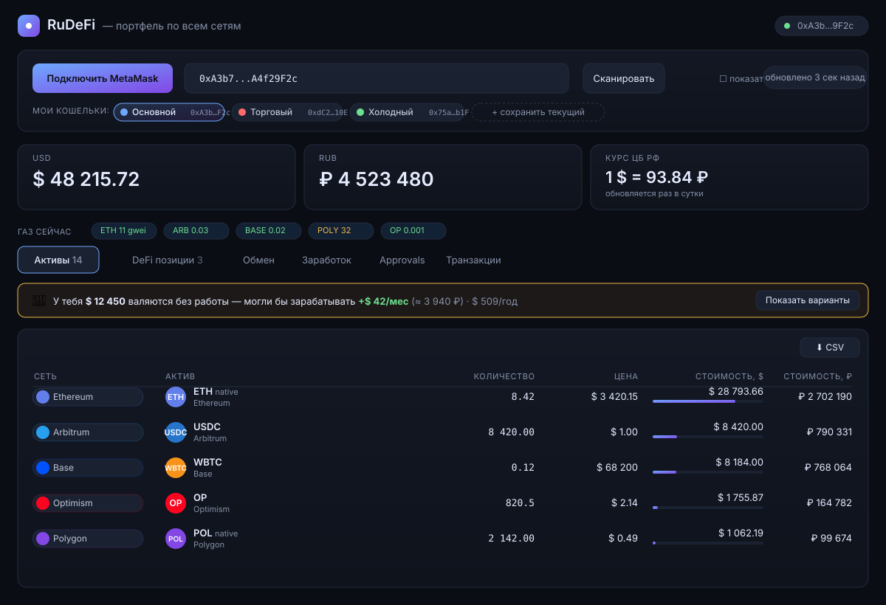
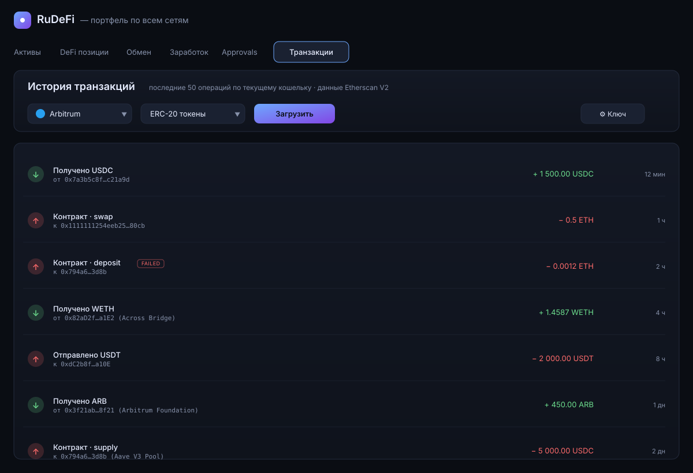
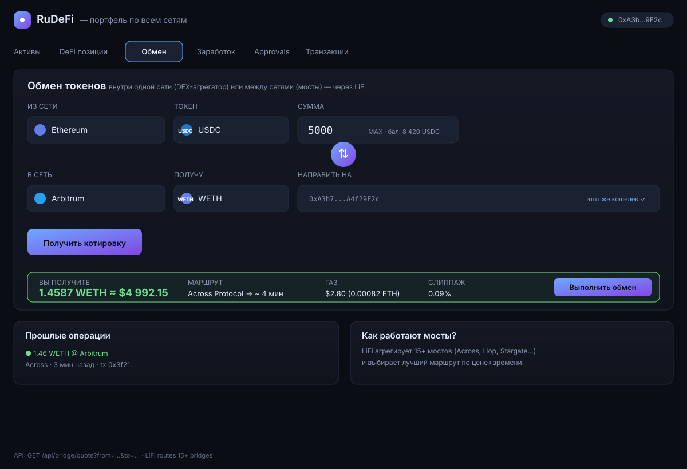
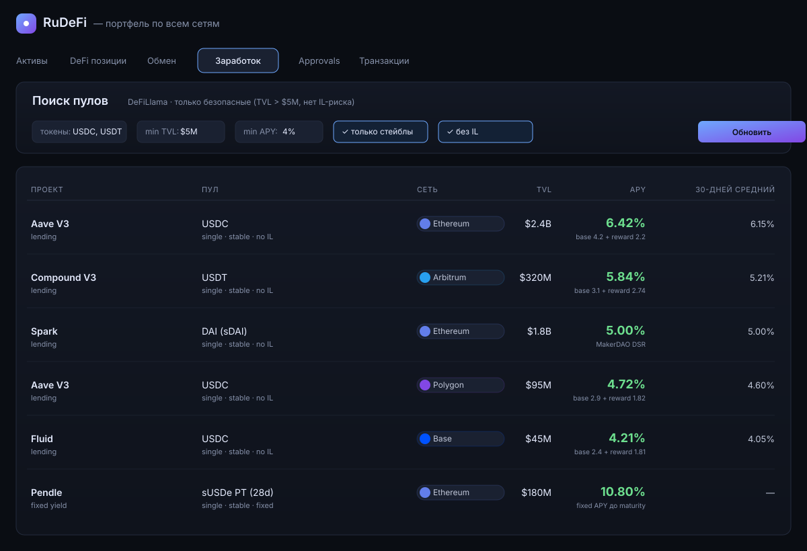
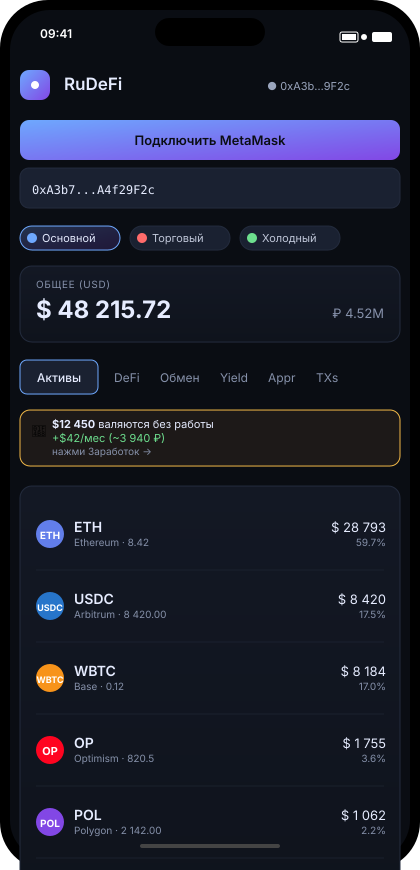
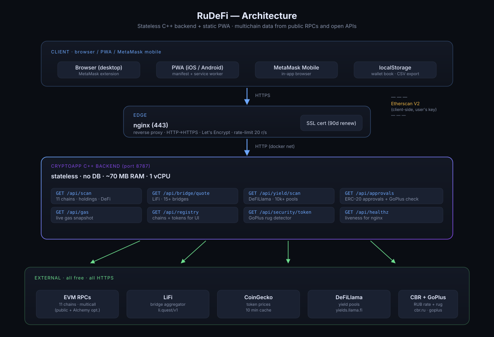

<div align="center">

# RuDeFi

**Multichain DeFi dashboard · self-hostable · wallet-first**

Scan 11 EVM chains, bridge between them, discover yield, manage approvals — in one PWA that runs on your own VPS, no custodian, no tracking, no accounts.

[Features](#features) · [Screenshots](#screenshots) · [Architecture](#architecture) · [Quick deploy](#quick-deploy) · [API](#api) · [Русский](README.ru.md)

</div>

---

## What it is

A small, fast, open-source alternative to Zerion / DeBank / Zapper that **you host yourself**. The backend is stateless C++ — it talks to public RPCs, CoinGecko, LiFi and DeFiLlama on your behalf and renders JSON. The frontend is a single HTML file with a service worker; it installs as a PWA on iPhone / Android.

Designed for P2P traders and anyone managing more than one wallet across more than one chain.

## Features

### Portfolio
- **11 EVM chains** out of the box — Ethereum, Arbitrum, Optimism, Base, Polygon, BNB Chain, Avalanche, Gnosis, Linea, Scroll, Blast.
- **Everything in one scan** — native coins, ERC-20 balances, Aave V3 / Spark / Compound V3 supply & borrow positions, Uniswap V3 LP positions.
- **Live FX** — portfolio value in USD and RUB (CBR daily reference rate), per-token allocation bars.
- **Idle-money banner** — tells you how much you could earn by moving idle balances into the best-APY pool on the same chain.

### Wallet book
- **Save multiple wallets** with human-readable labels and a color dot (Hot / Trading / Cold / DeFi / Payroll…).
- **One-click switch** between labeled wallets. Labels stay with you — nothing is sent to any server.
- **CSV export** of the current portfolio for bookkeeping (UTF-8 BOM, `;`-separated so Excel in RU/EU locales opens it clean).

### Bridges & swaps
- **LiFi routing** — the aggregator fans your trade across 15+ bridges and 20+ DEXes to find the cheapest+fastest path.
- **Pre-flight gas** and estimated time quoted in USD/RUB.
- **Same-wallet or cross-wallet destination** — the input accepts any 0x address.

### Yield scanner
- Pulls DeFiLlama's full pool list (~10k pools) and filters client-side on your criteria: minimum TVL, minimum APY, stablecoins-only, no-IL, single-exposure, specific tokens, specific chains.
- **"My tokens only" mode** suggests pools you can enter without first buying something else.

### Approvals manager
- Scans known DEX / bridge spenders across all chains for ERC-20 allowances you've granted.
- **GoPlus token check** on every row flags honeypots, blacklist functions, mintable supply, proxy upgrades.
- Revoke directly via MetaMask with one click.

### Transaction history (Etherscan V2)
- Last 50 operations per chain — normal / ERC-20 / internal — color-coded in/out with amount and counterparty.
- One free Etherscan API key covers all 11 chains (Universal API). Key is stored only in your browser.

### Mobile / PWA
- `manifest.webmanifest` + service worker + apple-touch-icon → **"Add to Home Screen"** gives a native-feeling app with no address bar.
- Responsive down to 320px. Works inside MetaMask Mobile's in-app browser so transactions sign on-device.

### Alerts
- Health-Factor monitor for Aave / Spark / Compound positions — browser notification + audio cue when HF drops below 1.5 (warning) or 1.1 (danger).

## Screenshots

<table>
  <tr>
    <td align="center"><strong>Portfolio</strong></td>
    <td align="center"><strong>Transactions</strong></td>
  </tr>
  <tr>
    <td></td>
    <td></td>
  </tr>
  <tr>
    <td align="center"><strong>Bridges / Swaps</strong></td>
    <td align="center"><strong>Yield scanner</strong></td>
  </tr>
  <tr>
    <td></td>
    <td></td>
  </tr>
</table>

<div align="center">
  <strong>Mobile PWA (installed via "Add to Home Screen")</strong><br/>
  
</div>

## Architecture



**Design choices:**

- **Stateless backend.** No database, no sessions, no user accounts. One `/api/scan` call is self-contained; horizontal scaling is just more copies of the same binary.
- **One C++ process.** The whole backend is a single `cryptoapp` binary built with CMake. All HTTP calls (RPCs, CoinGecko, LiFi, DeFiLlama, CBR, GoPlus) go through one libcurl pool.
- **Static frontend.** The UI is one `index.html` + a tiny service worker. No build step, no framework — paste into a CDN and it works. The service worker only caches shell files and bypasses `/api/*`.
- **Transaction history runs client-side.** The browser calls Etherscan V2 directly with the user's key. This keeps API keys out of a public deploy and lets you add the feature without touching the server.
- **No custody.** All signing happens in the user's wallet. The backend never sees a private key.

**Resource footprint on a typical scan:**

| Resource | Idle | Scanning |
|---|---|---|
| RAM (app container) | 50 MB | 100–150 MB |
| CPU (app container) | <1% | 15–40% for 2–4 s |
| Outbound requests | 0 | ~80–200 (multicalled) |

Comfortably fits inside a €4/mo Hetzner CX22 (2 vCPU, 4 GB RAM) with room to spare.

## Quick deploy

Full step-by-step guide: **[`DEPLOY.md`](DEPLOY.md)** (English) · [`DEPLOY-VPS.md`](DEPLOY-VPS.md) (Russian). Two paths:

### A) Fresh VPS with no other apps — full stack

```bash
git clone https://github.com/21astroboy/RuDeFi.git && cd RuDeFi
DOMAIN=rudefi.example.com EMAIL=you@gmail.com ./deploy.sh
```

Spins up `app` + `nginx` + `certbot`, gets a Let's Encrypt cert, serves `https://rudefi.example.com`. Takes 5–7 minutes end-to-end.

### B) VPS where other apps already own 80/443

```bash
git clone https://github.com/21astroboy/RuDeFi.git && cd RuDeFi
./deploy-standalone.sh
```

Starts the backend on `127.0.0.1:8080`, your existing nginx proxies to it. Drop `nginx-snippet.conf` into `sites-available/`, run `certbot --nginx -d rudefi.yourdomain` and you're done.

### C) Local development

```bash
# macOS
brew install cmake boost curl
cmake -B build && cmake --build build -j
./build/cryptoapp serve --port 8787

# Linux (Ubuntu 22.04+)
sudo apt install -y build-essential cmake libcurl4-openssl-dev libboost-dev
cmake -B build && cmake --build build -j
./build/cryptoapp serve --port 8787
```

Open `http://127.0.0.1:8787`.

### Optional: Alchemy

Public RPCs work out of the box but throttle under load. If you expect more than one active user, add your Alchemy key:

```bash
cp config/settings.example.json config/settings.json
# edit alchemy_api_key = "..."
```

Alchemy's free tier (30M CU/month) is enough for ~100 active portfolio users.

## API

Base URL: `/api` on the backend (default `http://127.0.0.1:8787`).

| Endpoint | What it does |
|---|---|
| `GET /api/healthz` | Liveness probe for nginx / monitoring |
| `GET /api/registry` | Chains + supported tokens (for UI dropdowns) |
| `GET /api/scan?wallet=0x…` | Portfolio scan across 11 chains, incl. DeFi positions |
| `GET /api/gas` | Live gas snapshot per chain |
| `GET /api/bridge/quote?from_chain=…&to_chain=…&from_token=…&to_token=…&amount=…&from_address=…` | LiFi route quote |
| `GET /api/bridge/build-tx?…` | Build the signed transaction payload |
| `GET /api/bridge/status?tx_hash=…` | Cross-chain tx status |
| `GET /api/yield/scan?symbols=…&chains=…&min_tvl=…&min_apy=…&stable_only=1` | DeFiLlama yield search |
| `GET /api/approvals?wallet=0x…` | ERC-20 allowances across known spenders |
| `GET /api/security/token?chain=…&address=0x…` | GoPlus rug / honeypot check |

All responses are JSON. The backend doesn't require authentication — put nginx-level IP allowlisting in front if you want to restrict access.

## Tech stack

- **Backend:** C++20, [cpp-httplib](https://github.com/yhirose/cpp-httplib), [nlohmann/json](https://github.com/nlohmann/json), [CLI11](https://github.com/CLIUtils/CLI11), libcurl. All fetched via CMake `FetchContent` on first build (~30 MB download).
- **Frontend:** vanilla JS, no framework, no build step. ~4000 LOC in one HTML file.
- **Infra:** Docker + docker-compose, nginx reverse proxy, Let's Encrypt (certbot).
- **Build:** CMake 3.20+, GCC 11+ / Clang 14+ / Apple Clang 14+. Builds on first run in a Docker container; ~3–7 min cold, under a minute warm.

## Credits

Open data from [LiFi](https://li.fi) (bridges), [DeFiLlama](https://defillama.com) (yields), [CoinGecko](https://coingecko.com) (prices), [GoPlus](https://gopluslabs.io) (token security), [Central Bank of Russia](https://cbr.ru) (USD→RUB rate), [Trust Wallet assets](https://github.com/trustwallet/assets) (token icons), [Etherscan](https://etherscan.io) (transaction history).

Public RPC endpoints courtesy of [Chainlist](https://chainlist.org) and the individual chain foundations.

## License

MIT — see [`LICENSE`](LICENSE). Dependencies retain their own licenses (all permissive).

---

<div align="center">
<sub>Not affiliated with any of the above services. Not financial advice. If it burns your money that's on you — it's a self-hosted wallet dashboard, not a bank.</sub>
</div>
