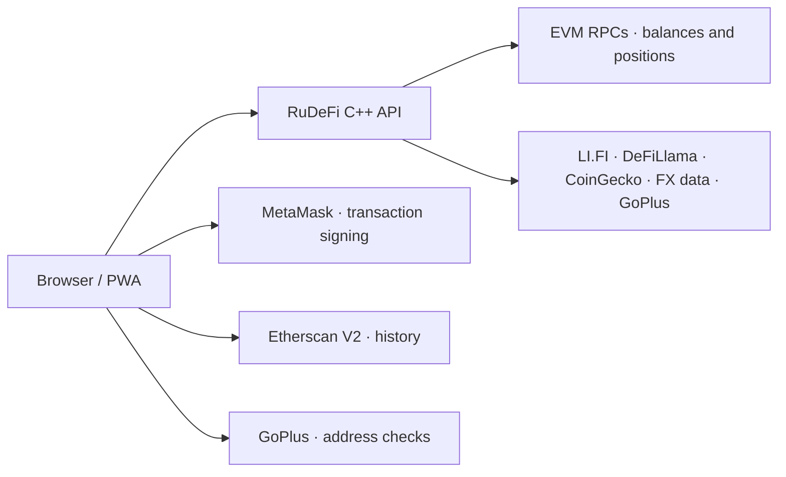

<div align="center">


# RuDeFi

### Your onchain workspace for P2P crypto workflows.

**Track wallets. Check addresses. Swap tokens. Move across chains.**

An open-source, Russian-language DeFi dashboard with MetaMask signing,
11 EVM networks, and a lightweight C++ backend.

[](LICENSE)
[](https://github.com/21astroboy/RuDeFi/actions/workflows/checks.yml)


[Русский](README.ru.md) · [Features](#built-for-the-onchain-side-of-p2p) · [Preview](#preview) · [Development](#local-development) · [Contribute](CONTRIBUTING.md)

</div>

---

## Built for the onchain side of P2P

P2P workflows often span several wallets, tokens, networks, and explorers. RuDeFi brings the onchain tools together: review a wallet, inspect address-risk signals, find a swap or bridge route, and check token approvals.

**RuDeFi is currently a wallet and DeFi toolkit.** It does not provide a fiat order book, counterparty matching, escrow, payment verification, or dispute resolution.

| Tool | What you can do |
| :--- | :--- |
| **Portfolio** | View native coins, configured ERC-20 tokens, and supported DeFi positions across 11 networks. See values in USD and RUB. |
| **Wallet book** | Label addresses, keep a watchlist, switch between portfolios, and export holdings to CSV. |
| **Address & token checks** | Review GoPlus risk signals for a counterparty address or token. Missing signals do not prove an address is safe. |
| **Swaps** | Compare LI.FI routes for exchanging tokens within one network. |
| **Bridges** | Compare LI.FI routes for moving tokens between different networks, with estimated gas and duration. |
| **Approvals** | Inspect allowances for configured tokens and known spenders; submit revocations through MetaMask. |
| **DeFi & yield** | View supported Aave V3, Spark, Compound V3, and Uniswap V3 positions; explore yield data from DeFiLlama. Coverage depends on network configuration. |
| **History** | Load normal transactions, ERC-20 transfers, or internal transactions through Etherscan V2, with an explorer link when a request fails. |

## Preview


*Actual application interface. Swaps and Bridges are separate sections, each retaining its own form inputs.*

## A practical workflow

1. **Review an address.** Paste an EVM address to inspect a portfolio, or connect MetaMask to use your own account.
2. **Check the counterparty.** Open the address check to review available risk signals before deciding how to proceed.
3. **Choose the network.** Use **Swaps** for a same-chain exchange or **Bridges** to move between networks.
4. **Review and sign.** Check the route, amount, gas, and wallet request. Signing happens in MetaMask.
5. **Keep track.** Review allowances and history; export holdings when you need a portfolio snapshot.

An address scan or risk signal is supporting information, not proof that a counterparty or fiat payment is legitimate.

## Wallets & mobile

**Desktop:** connect the MetaMask extension. EIP-6963 discovery prioritizes MetaMask when multiple wallets are installed.

**Mobile:** tap **Connect MetaMask**, then **Open in MetaMask** if the browser has no wallet provider. Continue inside MetaMask Mobile's browser and connect there. This opens a new browser context; it does not create a remote wallet session in Safari or Chrome.

The responsive interface includes a PWA manifest and service worker. Cached application files can be available offline; balances, quotes, checks, and transactions require a network connection.

## API keys

| Feature | Do users need to enter a key? |
| :--- | :--- |
| Portfolio, gas, address/token checks, yield | **No.** Uses configured public RPCs and external data services. |
| Swaps & bridges | **No.** LI.FI supports unauthenticated requests, subject to rate limits. |
| Transaction history inside the app | **Yes.** An Etherscan V2 key is required; network access depends on its plan. |
| Viewing history in a block explorer | **No app API key.** Open the explorer link. |

Executing a swap, bridge, or revocation requires a connected wallet and sufficient funds for the operation and network gas. External services can be unavailable or rate-limited. Backend requests share the server's upstream limits; see [LI.FI's rate-limit documentation](https://docs.li.fi/api-reference/rate-limits).

## Supported networks

**Ethereum · Arbitrum · Optimism · Base · Polygon · BNB Chain · Avalanche · Gnosis · Linea · Scroll · Blast**

Network and token coverage is defined in [`config/chains.json`](config/chains.json) and [`config/tokens.json`](config/tokens.json). The scanner uses configured token and protocol lists; it is not an exhaustive index of every asset or position on an address.

## How it works



- **Backend:** C++20, CMake, libcurl, Boost.Multiprecision, cpp-httplib, nlohmann/json, CLI11. No user database; external data and route quotes are cached in memory.
- **Frontend:** HTML, CSS, and vanilla JavaScript. No frontend bundler or framework required.
- **Wallet boundary:** private keys and signing stay in the wallet. The API builds unsigned transaction requests.
- **Browser storage:** saved addresses, wallet labels, preferences, and the Etherscan key are stored locally. The key is sent directly to Etherscan when requesting history.
- **External data:** scans and checks send requested addresses to the relevant RPC or data service. Local storage does not make those requests anonymous.

### Current boundaries

- The interface is currently in Russian and supports EVM addresses.
- In-app route execution supports **one LI.FI step**. Multi-step routes are displayed but cannot be executed in the app.
- Approval scans cover known spenders; they are not a complete allowance audit.
- Risk checks depend on upstream coverage. An empty result or a positive indicator is not a guarantee.
- Quotes, fees, balances, APYs, and exchange rates are estimates or snapshots and can change.
- This is an experimental application for real wallet interactions. Review transaction details before signing; there is no end-to-end guarantee from the automated tests.

## Local development

Requirements: a C++20 compiler, CMake 3.20+, Git, libcurl development files, Boost 1.74+, and Node.js 22+ for the JavaScript tests.

<details>
<summary><strong>Install build dependencies</strong></summary>

macOS with Homebrew:

```bash
brew install cmake boost curl node
```

Ubuntu:

```bash
sudo apt-get update
sudo apt-get install build-essential cmake git libcurl4-openssl-dev libboost-dev
```

Install Node.js separately if it is not already available.

</details>

```bash
git clone https://github.com/21astroboy/RuDeFi.git
cd RuDeFi
cmake -S . -B build -DCMAKE_BUILD_TYPE=Release
cmake --build build --parallel 2
./build/cryptoapp serve --bind 127.0.0.1 --port 8787
```

Open [localhost:8787](http://127.0.0.1:8787). Run the binary from the repository root so it can find `config/` and `ui/`. The internal executable name is still `cryptoapp`.

CMake downloads its declared header dependencies on first configuration. No wallet or API key is required to start the application.

Run the regression checks from the repository root:

```bash
node --test tests/*.cjs
node --check ui/sw.js
```

These checks simulate wallet providers and API responses. They do not send transactions or replace testing with a real wallet on desktop and mobile.

## Contributing

Bug reports, translations, accessibility improvements, and focused pull requests are welcome. Start with [CONTRIBUTING.md](CONTRIBUTING.md); use [Issues](https://github.com/21astroboy/RuDeFi/issues) for reproducible bugs and feature proposals.

For security-sensitive reports, follow [SECURITY.md](SECURITY.md). Do not include API keys, recovery phrases, or private keys in issues or screenshots.

### Areas for contribution

These are future directions, not currently available features:

- Broader wallet and mobile browser test coverage.
- Better route lifecycle handling, recovery, and multi-step execution.
- More complete transaction-history coverage and allowance discovery.
- Modular frontend code, accessibility, and interface translations.
- P2P workflow tools such as counterparty notes and trade records, with an explicit privacy model.

## Data & acknowledgements

[LI.FI](https://li.fi) · [DeFiLlama](https://defillama.com) · [CoinGecko](https://www.coingecko.com) · [GoPlus](https://gopluslabs.io) · [Etherscan](https://etherscan.io)

Powered by Etherscan.io APIs for transaction history. RUB conversion uses CBR reference-rate data distributed by [CBR XML Daily](https://www.cbr-xml-daily.ru). Token artwork comes from [Trust Wallet Assets](https://github.com/trustwallet/assets). Network data uses the RPC endpoints listed in the configuration.

RuDeFi is an independent project, not affiliated with these providers. Third-party data, services, and assets remain subject to their respective terms and licenses.

## License

RuDeFi source code is available under the [MIT License](LICENSE).
