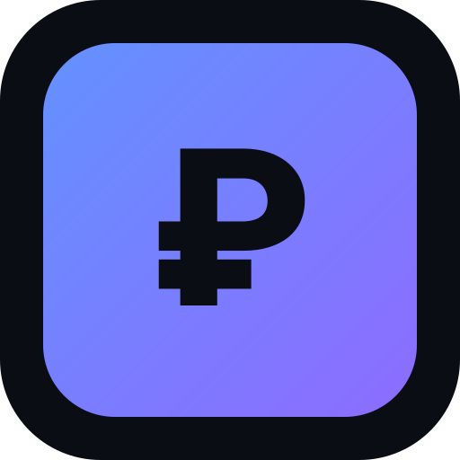
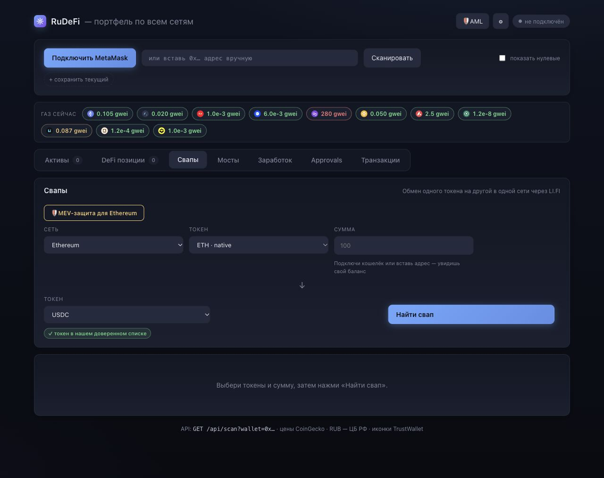
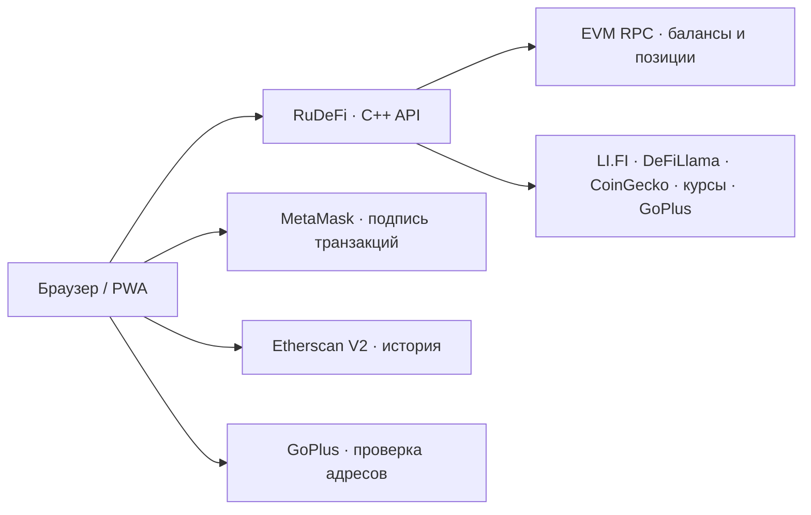

<div align="center">



# RuDeFi

### Рабочее пространство для ончейн-задач в P2P.

**Следи за кошельками. Проверяй адреса. Обменивай токены. Переводи между сетями.**

Открытый DeFi-дашборд на русском: MetaMask, 11 EVM-сетей
и компактный бэкенд на C++.

[](LICENSE)
[](https://github.com/21astroboy/RuDeFi/actions/workflows/checks.yml)


[English](README.md) · [Возможности](#возможности) · [Интерфейс](#интерфейс) · [Разработка](#локальная-разработка) · [Участие](CONTRIBUTING.md)

</div>

---

## Для чего нужен RuDeFi

В P2P приходится работать с несколькими адресами, токенами, сетями и обозревателями. RuDeFi объединяет ончейн-инструменты: просмотр портфеля, проверку сигналов риска, поиск маршрута обмена или моста и управление разрешениями токенов.

**Сейчас RuDeFi — набор инструментов для кошельков и DeFi.** В приложении нет биржи объявлений, подбора контрагента, эскроу, проверки фиатного платежа и арбитража споров.

## Возможности

| Раздел | Что можно делать |
| :--- | :--- |
| **Портфель** | Смотреть нативные монеты, настроенные ERC-20 токены и поддерживаемые DeFi-позиции в 11 сетях. Оценивать активы в USD и RUB. |
| **Адресная книга** | Сохранять адреса с метками, переключать портфели, выгружать активы в CSV. |
| **Проверка адресов и токенов** | Изучать сигналы GoPlus перед взаимодействием с контрагентом или токеном. Отсутствие сигналов не доказывает безопасность. |
| **Свапы** | Сравнивать маршруты LI.FI для обмена токенов внутри одной сети. |
| **Мосты** | Сравнивать маршруты LI.FI между разными сетями, оценивать газ и длительность перевода. |
| **Approvals** | Проверять разрешения настроенных токенов для известных контрактов и отзывать их через MetaMask. |
| **DeFi и доходность** | Смотреть поддерживаемые позиции Aave V3, Spark, Compound V3 и Uniswap V3; искать пулы по данным DeFiLlama. Покрытие зависит от сети и конфигурации. |
| **История** | Загружать обычные транзакции, ERC-20 переводы и внутренние транзакции через Etherscan V2; при ошибке переходить в обозреватель. |

## Интерфейс



*Снимок работающего приложения. «Свапы» и «Мосты» — отдельные разделы, каждый сохраняет свои параметры формы.*

## Сценарий работы

1. **Посмотри адрес.** Вставь EVM-адрес для просмотра портфеля или подключи MetaMask.
2. **Изучи контрагента.** Открой проверку адреса и посмотри доступные сигналы риска.
3. **Выбери направление.** «Свапы» — обмен внутри сети; «Мосты» — перевод между сетями.
4. **Проверь операцию.** Сверь сумму, маршрут, газ и запрос кошелька. Подпись выполняется в MetaMask.
5. **Веди учёт.** Проверяй разрешения и историю, экспортируй снимок портфеля в CSV.

Проверка адреса помогает собрать информацию, но не подтверждает добросовестность контрагента или получение фиатного платежа.

## MetaMask и мобильная версия

**Компьютер:** подключение через расширение MetaMask. Обнаружение по EIP-6963 отдаёт приоритет MetaMask, если установлено несколько кошельков.

**Телефон:** нажми «Подключить MetaMask». Если провайдер не найден, выбери «Открыть сайт в MetaMask», затем подключись во встроенном браузере приложения. Этот переход открывает новый браузерный контекст; удалённая сессия кошелька в Safari или Chrome не создаётся.

Есть адаптивный интерфейс, PWA-манифест и service worker. Сохранённые файлы интерфейса могут открываться офлайн; для балансов, котировок, проверок и транзакций нужен интернет.

## Нужны ли API-ключи?

| Возможность | Нужно вводить ключ? |
| :--- | :--- |
| Портфель, газ, проверки адресов и токенов, доходность | **Нет.** Используются публичные RPC и внешние сервисы данных. |
| Свапы и мосты | **Нет.** LI.FI принимает запросы без ключа, с ограничениями частоты. |
| История внутри приложения | **Да.** Нужен Etherscan V2; доступ к сетям зависит от тарифа ключа. |
| История в обозревателе | **Ключ приложения не нужен.** Можно перейти по ссылке. |

Для исполнения свапа, моста или отзыва разрешения нужны подключённый кошелёк и средства на операцию и газ. Внешние сервисы могут быть недоступны или ограничивать запросы. Запросы бэкенда используют общий лимит сервера — [подробнее о лимитах LI.FI](https://docs.li.fi/api-reference/rate-limits).

## Сети

**Ethereum · Arbitrum · Optimism · Base · Polygon · BNB Chain · Avalanche · Gnosis · Linea · Scroll · Blast**

Сети и токены задаются в [`config/chains.json`](config/chains.json) и [`config/tokens.json`](config/tokens.json). Сканер проверяет настроенные списки токенов и протоколов, а не индексирует все возможные активы и позиции адреса.

## Устройство проекта



- **Бэкенд:** C++20, CMake, libcurl, Boost.Multiprecision, cpp-httplib, nlohmann/json и CLI11. Нет базы пользователей; внешние данные и котировки кэшируются в памяти.
- **Интерфейс:** HTML, CSS и обычный JavaScript. Сборщик фронтенда не нужен.
- **Подпись:** приватные ключи остаются в кошельке. Сервер формирует неподписанные запросы транзакций.
- **Локальные данные:** адреса, метки, настройки и ключ Etherscan сохраняются в браузере. При загрузке истории ключ отправляется напрямую в Etherscan.
- **Внешние запросы:** проверяемые адреса передаются соответствующим RPC и сервисам данных. Локальное хранение настроек не делает запросы анонимными.

### Текущие ограничения

- Интерфейс на русском; поддерживаются EVM-адреса.
- В приложении исполняются маршруты с **одним шагом LI.FI**. Многошаговые маршруты показываются, но кнопка исполнения отключена.
- Скан разрешений охватывает известные контракты и не заменяет полный аудит allowances.
- Результаты проверок зависят от покрытия внешних источников и не дают гарантии безопасности.
- Котировки, комиссии, балансы, APY и валютные курсы могут меняться.
- Приложение экспериментальное и взаимодействует с реальными кошельками. Проверяй запрос перед подписью; автоматические тесты не гарантируют успешное исполнение сделки.

## Локальная разработка

Нужны компилятор C++20, CMake 3.20+, Git, заголовки libcurl, Boost 1.74+ и Node.js 22+ для JavaScript-тестов.

<details>
<summary><strong>Зависимости для сборки</strong></summary>

macOS с Homebrew:

```bash
brew install cmake boost curl node
```

Ubuntu:

```bash
sudo apt-get update
sudo apt-get install build-essential cmake git libcurl4-openssl-dev libboost-dev
```

Если Node.js ещё не установлен, установи его отдельно.

</details>

```bash
git clone https://github.com/21astroboy/RuDeFi.git
cd RuDeFi
cmake -S . -B build -DCMAKE_BUILD_TYPE=Release
cmake --build build --parallel 2
./build/cryptoapp serve --bind 127.0.0.1 --port 8787
```

Открой [localhost:8787](http://127.0.0.1:8787). Запускай из корня репозитория, чтобы приложение находило `config/` и `ui/`. Внутреннее имя исполняемого файла пока — `cryptoapp`.

При первой конфигурации CMake загружает объявленные зависимости. Для запуска приложения не нужны кошелёк или API-ключ.

Проверки из корня репозитория:

```bash
node --test tests/*.cjs
node --check ui/sw.js
```

Тесты используют имитации провайдеров кошелька и ответов API. Они не отправляют транзакции и не заменяют проверку с настоящим кошельком на компьютере и телефоне.

## Участие в проекте

Приветствуются воспроизводимые баг-репорты, переводы, улучшения доступности и небольшие pull request. Начни с [CONTRIBUTING.md](CONTRIBUTING.md). Ошибки и предложения можно обсуждать в [Issues](https://github.com/21astroboy/RuDeFi/issues).

Об уязвимостях сообщай по правилам [SECURITY.md](SECURITY.md). Не публикуй API-ключи, seed-фразы и приватные ключи в issue или скриншотах.

### Куда можно развивать проект

Это направления для будущих изменений, а не уже доступные функции:

- Расширить тестирование кошельков и мобильных браузеров.
- Улучшить отслеживание операций, восстановление и многошаговые маршруты.
- Расширить историю транзакций и поиск разрешений токенов.
- Разделить фронтенд на модули, улучшить доступность, добавить языки интерфейса.
- Добавить заметки о контрагентах и журнал P2P-сделок с понятной моделью приватности.

## Источники данных

[LI.FI](https://li.fi) · [DeFiLlama](https://defillama.com) · [CoinGecko](https://www.coingecko.com) · [GoPlus](https://gopluslabs.io) · [Etherscan](https://etherscan.io)

Powered by Etherscan.io APIs — история транзакций. Для RUB используются справочные курсы ЦБ РФ через [CBR XML Daily](https://www.cbr-xml-daily.ru). Иконки токенов — [Trust Wallet Assets](https://github.com/trustwallet/assets). RPC-адреса указаны в конфигурации сетей.

RuDeFi — независимый проект, не связанный с перечисленными провайдерами. У внешних сервисов, данных и графических материалов действуют собственные условия и лицензии.

## Лицензия

Исходный код RuDeFi доступен по [лицензии MIT](LICENSE).
